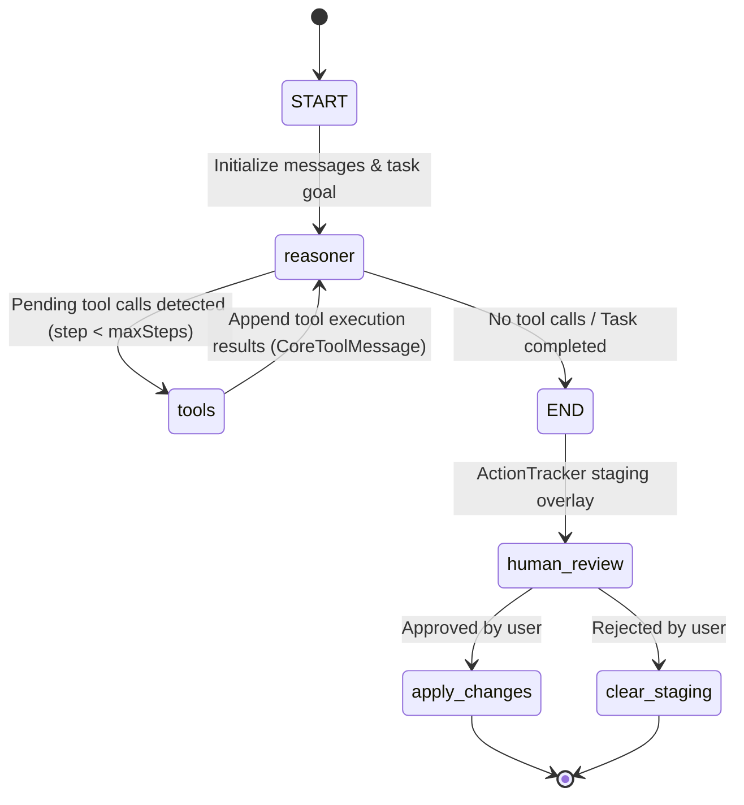

# 📚 PC Brew // Master Resources & Architecture Directory

> **Comprehensive resource index, API key guides, architecture specifications, and website companion assets for `pcbrew`.**

---

## 📑 Table of Contents

1. [Core Project Resources](#1-core-project-resources)
2. [Interactive Setup Wizard & Config Store](#2-interactive-setup-wizard--config-store)
3. [API Keys & Third-Party Service Portals](#3-api-keys--third-party-service-portals)
   - [OpenRouter (LLM Engine)](#a-openrouter-ai)
   - [Telegram BotFather & UserInfoBot](#b-telegram-bot--authorization)
   - [WhatsApp (Baileys Engine)](#c-whatsapp-remote-controller)
   - [Firecrawl (Web Scraping & Search)](#d-firecrawl-web-search)
4. [PC Brew Website Companion (`web/`)](#4-pc-brew-website-companion-web)
   - [Component Hierarchy](#component-hierarchy)
   - [Styling & Design Tokens](#styling--design-tokens)
   - [Running the Website](#running-the-website)
5. [Cross-Platform Installation Scripts](#5-cross-platform-installation-scripts)
   - [Windows (PowerShell)](#windows-powershell)
   - [macOS (zsh)](#macos-zsh)
   - [Linux / Cloud VPS (bash)](#linux--cloud-vps-bash)
6. [Complete Command Reference Matrix](#6-complete-command-reference-matrix)
7. [Virtual Memory Staging & Security Model](#7-virtual-memory-staging--security-model)

---

## 1. Core Project Resources

| Resource | Value / Path | Description |
| :--- | :--- | :--- |
| **Package Name** | `pcbrew` | Primary Bun & npm package name |
| **Primary Binary** | `pcbrew` | Main CLI entrypoint executable |
| **Binary Aliases** | `jobhunt`, `jobhunter`, `jobhuntercli` | Backward-compatible symlinks |
| **Runtime Target** | Bun v1.4+ (or Node v20+) | Native TypeScript runtime with zero compile overhead |
| **CLI Framework** | Commander v15 + Clack Prompts | Clean command routing with interactive TUI widgets |
| **AI Framework** | Vercel AI SDK (`ai`) | `ToolLoopAgent` with structured tool calling |
| **WhatsApp Library**| `@whiskeysockets/baileys` v7 | Multi-device WhatsApp socket with QR authentication |
| **Telegram Library**| `telegraf` v4 | Long-polling Telegram bot with inline keyboards |

---

## 2. Interactive Setup Wizard & Config Store

PC Brew features a built-in step-by-step interactive setup wizard powered by `@clack/prompts` and `conf`.

### Launching the Setup Wizard
Run this command from any terminal:
```bash
pcbrew setup
# or
pcbrew config
```

### Automatic First-Run Detection
If you launch `pcbrew` or `pcbrew start` on a fresh system where no API keys are detected, the CLI automatically asks:
```text
⚠️  No OpenRouter API key detected on this system.
? Would you like to run the PC Brew interactive configuration wizard now? (Y/n)
```

### Config Storage Locations
Configurations are stored permanently in your user profile (surviving terminal reboots and directory changes):
- **Windows**: `%APPDATA%\pcbrew-nodejs\Config\config.json`
- **macOS**: `~/.config/pcbrew-nodejs/config.json`
- **Linux**: `~/.config/pcbrew-nodejs/config.json`

### Stored Keys Schema
```json
{
  "OPENROUTER_API_KEY": "sk-or-v1-...",
  "OPENROUTER_DEFAULT_MODEL": "openrouter/free",
  "TELEGRAM_BOT_TOKEN": "7123456789:AAH...",
  "TELEGRAM_OWNER_ID": "123456789",
  "WHATSAPP_OWNER_NUMBER": "919876543210",
  "FIRECRAWL_API_KEY": "fc-..."
}
```

---

## 3. API Keys & Third-Party Service Portals

### A. Supported LLM Engines & API Keys

PC Brew supports any major LLM engine:

#### 1. OpenRouter (Default / Multi-Model)
- **Portal**: [https://openrouter.ai/keys](https://openrouter.ai/keys)
- **Env Variable**: `OPENROUTER_API_KEY` (and `OPENROUTER_DEFAULT_MODEL`)
- **Key Format**: `sk-or-v1-xxxx...`
- **Models**: `openrouter/free`, `anthropic/claude-3.5-sonnet`, `deepseek/deepseek-chat`, `openai/gpt-4o-mini`

#### 2. OpenAI
- **Portal**: [https://platform.openai.com/api-keys](https://platform.openai.com/api-keys)
- **Env Variable**: `OPENAI_API_KEY` (and `OPENAI_MODEL`)
- **Key Format**: `sk-proj-xxxx...`
- **Models**: `gpt-4o-mini`, `gpt-4o`, `o1`, `o3-mini`

#### 3. Anthropic Claude
- **Portal**: [https://console.anthropic.com/](https://console.anthropic.com/)
- **Env Variable**: `ANTHROPIC_API_KEY` (and `ANTHROPIC_MODEL`)
- **Key Format**: `sk-ant-api03-xxxx...`
- **Models**: `claude-3-5-sonnet-latest`, `claude-3-5-haiku-latest`, `claude-3-opus-latest`

#### 4. Google Gemini
- **Portal**: [https://aistudio.google.com/app/apikey](https://aistudio.google.com/app/apikey)
- **Env Variable**: `GEMINI_API_KEY` (and `GOOGLE_MODEL`)
- **Key Format**: `AIzaSyxxxx...`
- **Models**: `gemini-1.5-flash`, `gemini-1.5-pro`

---

### B. Telegram Bot & Authorization
- **Bot Creation Portal**: Telegram app > [`@BotFather`](https://t.me/BotFather)
- **Owner ID Identification**: Telegram app > [`@userinfobot`](https://t.me/userinfobot)
- **How to Configure**:
  1. Message `@BotFather` on Telegram.
  2. Send `/newbot`, name your bot (e.g. `My PC Brew Bot`), and assign a username ending in `bot` (e.g. `my_pcbrew_bot`).
  3. Copy the HTTP token into `TELEGRAM_BOT_TOKEN`.
  4. Message `@userinfobot` on Telegram and copy your numeric `Id` into `TELEGRAM_OWNER_ID`.
- **Security Guarantee**: PC Brew rejects all commands from chat IDs that do not match `TELEGRAM_OWNER_ID`.

---

### C. WhatsApp (Remote Controller)
- **Engine**: Baileys multi-device protocol.
- **How to Pair**:
  1. Run `pcbrew whatsapp`.
  2. A dynamic ASCII QR code will generate in your terminal.
  3. On your phone: **WhatsApp** > **Settings** > **Linked Devices** > **Link a Device**.
  4. Scan the QR code.
  5. Credentials are saved locally in `.whatsapp_auth/` for instant reconnects.
- **Authorization**:
  - Use your linked **"Message yourself"** chat.
  - Or set `WHATSAPP_OWNER_NUMBER=countrycode+number` (e.g. `919876543210`).
  - Fallback command: Send `/claim` or `/auth` from WhatsApp to claim operator privileges.

---

### D. Firecrawl (Web Search)
- **Portal**: [https://www.firecrawl.dev/](https://www.firecrawl.dev/)
- **Purpose**: Allows `/plan` and `/ask` modes to scrape live job boards, documentation pages, or web repositories.
- **Optional**: If omitted, PC Brew runs purely against local workspace files.

---

## 4. PC Brew Website Companion (`web/`)

The repository includes a modern Next.js web application built with **Tailwind CSS**, **Framer Motion**, and **GSAP**.

### Component Hierarchy
```text
web/
├── src/
│   ├── app/
│   │   ├── globals.css              # Cyberpunk terminal scanlines & CRT overlays
│   │   ├── layout.tsx               # Root HTML layout with dark theme
│   │   └── page.tsx                 # Main single-page interactive portal
│   └── components/
│       ├── Navbar.tsx               # Top navigation with live status beacon
│       ├── TerminalSimulator.tsx    # Live interactive Agent Terminal sandbox
│       ├── GlobalSetupGuide.tsx     # OS tabs (Windows, macOS, Linux) with copy actions
│       ├── ArchitectureSection.tsx  # Deep dive into the 4 modes
│       ├── TelegramGuide.tsx        # Mobile Telegram mockup with inline keyboards
│       ├── WhatsAppGuide.tsx        # Mobile WhatsApp mockup with command flow
│       ├── EnvConfigurator.tsx      # Live .env and config store generator
│       ├── CommandsCheatsheet.tsx   # Searchable matrix of all commands
│       └── Footer.tsx               # Brand footer & safety overlay badge
```

### Styling & Design Tokens
- **Background**: `#05070b` (Deep void black)
- **Card Surfaces**: `#0d111a` (Subtle blue-gray tint)
- **Accent Gold**: `#b68f2d` / `#f5b72e` (Terminal amber brew)
- **Cyber Cyan**: `#00f3ff` (Data streams & system telemetry)
- **Matrix Green**: `#00ff9d` (Online indicators & file additions)
- **Rose Red**: `#ff4d4f` (Staged deletions & warning states)
- **Typography**: Monospace (`JetBrains Mono`, `Fira Code`, `Consolas`)

### Running the Website
From the project root:
```bash
bun run web:dev
```
Or directly from `web/`:
```bash
cd web
bun run dev
```
Open **`http://localhost:3000`** in any browser.

---

## 5. Cross-Platform Installation Scripts

### Windows (PowerShell)
```powershell
# 1. Install Bun
powershell -c "irm bun.sh/install.ps1 | iex"

# 2. Clone repository
git clone <repo-url> pcbrew
cd pcbrew

# 3. Install & link
bun install
npm link --force

# 4. Run setup wizard
pcbrew setup

# 5. Start terminal
pcbrew start
```

---

### macOS (zsh)
```bash
# 1. Install Bun
curl -fsSL https://bun.sh/install | bash
source ~/.zshrc

# 2. Clone repository
git clone <repo-url> pcbrew
cd pcbrew

# 3. Install & link
bun install
sudo npm link

# 4. Run setup wizard
pcbrew setup

# 5. Start terminal
pcbrew start
```

---

### Linux / Cloud VPS (bash)
```bash
# 1. Install Bun
curl -fsSL https://bun.sh/install | bash
export PATH="$HOME/.bun/bin:$PATH"

# 2. Clone repository
git clone <repo-url> pcbrew
cd pcbrew

# 3. Install & compile standalone binary
bun install
bun build --compile --outfile /usr/local/bin/pcbrew ./index.ts
sudo chmod +x /usr/local/bin/pcbrew

# 4. Run setup wizard
pcbrew setup

# 5. Start background WhatsApp or Telegram daemon
pcbrew whatsapp
```

---

## 6. Complete Command Reference Matrix

### Terminal & Slash Commands

| Channel | Command | Parameters | Description |
| :--- | :--- | :--- | :--- |
| **Shell** | `pcbrew` | None | Launches default Agentic Terminal |
| **Shell** | `pcbrew setup` | None | Interactive one-by-one API setup wizard |
| **Shell** | `pcbrew start` | None | Starts interactive REPL directly |
| **Shell** | `pcbrew wakeup`| None | Opens TUI ASCII banner & mode selector |
| **Shell** | `pcbrew telegram` | None | Runs Telegram Bot listener directly |
| **Shell** | `pcbrew whatsapp` | None | Runs WhatsApp Laptop Controller with QR |
| **REPL** | `/config` | None | Launches API setup wizard from inside REPL |
| **REPL** | `/plan` | `<goal>` | Generates ordered implementation plan |
| **REPL** | `/agent` | `<task>` | Runs autonomous tool loop with staged diffs |
| **REPL** | `/ask` | `<question>` | Codebase exploration and reasoning |
| **REPL** | `/cmd` (or `$`) | `<command>` | Host terminal execution |
| **REPL** | `/sysinfo` | None | Host CPU, RAM, battery, OS telemetry |
| **REPL** | `/mode` | None | Opens wakeup selector |
| **REPL** | `/clear` | None | Clears terminal canvas |
| **REPL** | `/help` | None | Displays slash command cheat sheet |

---

### Telegram Remote Commands

| Command / Callback | Description |
| :--- | :--- |
| `/start` | Welcome message and authorized status |
| `/ask <question>` | Remotely query codebase architecture |
| `/agent <task>` | Run autonomous agent with inline keyboard approvals |
| `/plan <goal>` | Generate plan with interactive step toggle buttons |
| `plan_toggle:<id>` | Toggle specific step selection checkbox |
| `plan_proceed` | Dispatch agent to run all selected steps |
| `approval_diff` | Send unified git diff to chat |
| `approval_accept` | Commit staged changes to local disk |
| `approval_reject` | Discard staged changes safely |

---

### WhatsApp Laptop Controller Commands

| Command | Category | Description |
| :--- | :--- | :--- |
| `/help` | General | Complete laptop controller documentation |
| `/sysinfo` | Telemetry | CPU usage, available RAM, battery %, uptime |
| `/cmd <command>` | Shell | Execute shell command on laptop ($ works too) |
| `/open <target>` | System | Open app or URL on laptop screen |
| `/ls [path]` | Filesystem | Browse laptop directories and files |
| `/agent <task>` | AI Agent | Run autonomous agent on laptop codebase |
| `/diff` | Safety | Preview staged diff in chat |
| `/approve` | Safety | Apply staged diff to laptop filesystem |
| `/reject` | Safety | Discard staged changes safely |
| `/claim` / `/auth` | Security | Pair sender as master laptop operator |

---

## 7. Virtual Memory Staging & Security Model

PC Brew never allows an AI agent to write directly to your filesystem without review:

1. **Memory Isolation**: File and folder mutations (`create_file`, `modify_file`, `delete_file`, `move_file`, `create_folder`, `delete_folder`) are captured in `ActionTracker` virtual memory overlay.
2. **Unified Diff Generation**: A standard patch is generated showing additions in green (`+`) and deletions in red (`-`), with dedicated folder creation and recursive deletion confirmation.
3. **Explicit Gate**:
   - In CLI: User types `y` or `n`, or reviews changes one-by-one.
   - In Telegram: User taps `[Accept All]` or `[Reject All]`.
   - In WhatsApp: User sends `/approve` or `/reject`.
4. **Zero Accidental Overwrites**: If rejected, the virtual memory buffer is flushed, leaving the disk completely untouched.

---

## 8. LangGraph Agent Engine (`@langchain/langgraph`)

Agent Mode is powered by a compiled LangGraph `StateGraph` state machine combining autonomous reasoning loops with strict safety overlays.

### LangGraph State Machine Architecture



### Complete Filesystem CRUD Operation Matrix

| Tool | Scope | Operation | Staging & Execution Policy |
| :--- | :--- | :--- | :--- |
| `create_file` | File | **Create** | Stages file content in-memory; created on approval |
| `read_file` | File | **Read** | Reads text file with path-traversal & size guards |
| `modify_file` | File | **Update** | Stages replacement content; produces unified diff |
| `delete_file` | File | **Delete** | Stages file deletion; removed on approval |
| `move_file` | File | **Move / Rename** | Stages source deletion + destination creation |
| `create_folder` | Folder | **Create** | Stages directory path; runs `mkdir -p` on approval |
| `list_files` | Folder | **Read / Browse** | Flat or recursive directory exploration |
| `delete_folder` | Folder | **Delete** | Stages recursive folder removal (`rm -rf` on approval) |
| `search_files` | Workspace | **Search** | Glob matching with optional content substring filter |
| `analyze_codebase` | Workspace | **Telemetry** | Directory and file structure counts & metrics |
| `execute_shell` | System | **Command** | Queues shell command to run after user approval |
| `list_skills` / `read_skill` | Cursor/Claude | **Extensibility** | Reads `SKILL.md` workflows from standard skill directories |
