# Incident & Mistake Analysis: `AI_APICallError: No models provided`

## 1. Error Summary
When running Agent Mode, the application threw the following runtime error:
```text
AI_APICallError: No models provided
      cause: undefined,
        url: "https://openrouter.ai/api/v1/chat/completions",
 requestBodyValues: {
  model: undefined,
  models: undefined,
  ...
 }
 statusCode: 400,
 responseBody: "{\"error\":{\"message\":\"No models provided\",\"code\":400},\"user_id\":\"...\"}"
```

---

## 2. Root Cause Analysis & Mistakes

### Mistake 1: Environment Variable Typo in `.env`
In `.env`:
```env
OPENROUTER_DEFAULT_MODE = 'openrouter/free'
```
* The variable was defined as `OPENROUTER_DEFAULT_MODE` (ending with **`MODE`**).
* But the code in `ai/ai.config.ts` was attempting to read:
  ```typescript
  const modelId = process.env.OPENROUTER_DEFAULT_MODEL; // (ending with MODEL)
  ```
* Because of the missing letter `L`, `process.env.OPENROUTER_DEFAULT_MODEL` evaluated to `undefined`.

### Mistake 2: Missing Fallback & TypeScript Type Mismatch in `ai/ai.config.ts`
* `ai/ai.config.ts` passed `modelId` directly to `provider(modelId)`.
* In TypeScript:
  * `process.env.OPENROUTER_DEFAULT_MODEL` is typed as `string | undefined`.
  * The OpenRouter SDK factory `provider(modelId: string)` strictly expects a `string`.
  * This was producing TypeScript compile error `TS2769: Argument of type 'string | undefined' is not assignable to parameter of type 'string'`.
* Without a fallback or validation check, `modelId` was passed as `undefined` at runtime.

### Mistake 3: OpenRouter API Payload Failure
* When `modelId` is `undefined`, the OpenRouter SDK generates an HTTP payload with:
  ```json
  {
    "model": undefined,
    "models": undefined
  }
  ```
* OpenRouter API rejected this request with HTTP status `400 Bad Request` and error:
  ```json
  {
    "error": {
      "message": "No models provided",
      "code": 400
    }
  }
  ```

---

## 3. Solution Applied

Following the required constraints (**do not modify `.env` or database models**, **follow TypeScript**, and **avoid touching routes**):

1. **Updated `ai/ai.config.ts`**:
   - Added backwards-compatible support for `OPENROUTER_DEFAULT_MODEL` or the existing `.env` key `OPENROUTER_DEFAULT_MODE`.
   - Added a fallback default model (`"openrouter/free"`).
   - Fixed typo variable name `provier` to `provider`.
   - Explicitly typed `modelId: string` to satisfy the TypeScript compiler.

```typescript
import { createOpenRouter } from "@openrouter/ai-sdk-provider";

export function getAgentModel() {
  const provider = createOpenRouter({ apiKey: process.env.OPENROUTER_API_KEY });

  const modelId: string =
    process.env.OPENROUTER_DEFAULT_MODEL ||
    process.env.OPENROUTER_DEFAULT_MODE ||
    "openrouter/free";

  return provider(modelId);
}
```

2. **Verification**:
   - `bunx tsc --noEmit` passed with 0 errors.
   - Tested model instantiation: `getAgentModel()` now correctly sets `modelId: "openrouter/free"`.


---

# Architecture Research: Publishing Global NPM CLI with User-Configured API Keys & Telegram (BYOK Pattern)

## 1. Overview & Problem Definition
When developing a CLI locally, developers typically rely on a local `.env` file for credentials (`OPENROUTER_API_KEY`, `TELEGRAM_BOT_TOKEN`, `TELEGRAM_OWNER_ID`). 

However, when distributed as a public or global NPM CLI (`npm install -g pcbrew` or `npx pcbrew`):
1. **The user runs the CLI from any directory** (e.g. `C:\Users\John\projects` or `~`), meaning no local `.env` exists in their working directory.
2. **Hardcoding or bundling developer `.env` files into an npm package is a severe security risk** that exposes developer secrets to the public registry.
3. **Users have different requirements**: Some users want to bring paid API keys (higher rate limits/custom models), while others want free/unpaid keys or trial tiers. Additionally, each user must route notifications to their personal Telegram account.

This requires implementing the **BYOK (Bring Your Own Key)** architecture standard among production CLIs (e.g., Vercel, Supabase, Stripe, GitHub CLI).

---

## 2. Bring-Your-Own-Key (BYOK) Architectural Pattern

```mermaid
flowchart TD
    subgraph Installation
        A["End User runs: npm install -g pcbrew"]
    end

    subgraph Configuration Phase
        B["User runs: pcbrew config"]
        C["Interactive Prompts (@clack/prompts)"]
        D["User provides API key (Paid/Free) & Telegram credentials"]
        E["Atomic persistence into OS Config directory (via conf)"]
        B --> C --> D --> E
    end

    subgraph Execution Phase
        F["User runs: pcbrew wakeup (or CLI/Telegram mode)"]
        G{"Resolve Credentials"}
        H["1. Check process.env (Terminal overrides)"]
        I["2. Check OS persistent store (conf)"]
        J["3. Fall back to defaults or prompt user"]
        K["Bot starts & invokes with user credentials"]
        F --> G
        G --> H --> I --> J --> K
    end
```



---

## 3. Persistent Configuration Storage Engine (`conf`)

CLIs persist configuration in standard, OS-specific user preference directories:
* **Windows**: `%APPDATA%\pcbrew\config.json` (e.g. `C:\Users\<User>\AppData\Roaming\pcbrew\config.json`)
* **macOS**: `~/Library/Preferences/pcbrew-nodejs/config.json`
* **Linux**: `~/.config/pcbrew/config.json`

The [`conf`](https://www.npmjs.com/package/conf) package is the standard solution for this pattern:
* Cross-platform directory resolution.
* Atomic file writes (prevents file corruption on process interruption).
* First-class TypeScript generics for schema validation.

### Installation
```bash
bun add conf
```

---

## 4. Implementation: Type-Safe Config Store (`config/store.ts`)

```typescript
import Conf from "conf";

export interface AppConfig {
  openRouterApiKey?: string;
  openRouterModel?: string;
  telegramBotToken?: string;
  telegramOwnerId?: string;
}

export const configStore = new Conf<AppConfig>({
  projectName: "pcbrew",
  defaults: {
    openRouterModel: "openrouter/free",
  },
});

/**
 * Resolves credentials by precedence:
 * 1. Process environment variables (CI/CD or explicit command-line overrides)
 * 2. Persistent user config store (saved via `pcbrew config`)
 * 3. Default fallbacks
 */
export function getResolvedConfig(): AppConfig {
  return {
    openRouterApiKey:
      process.env.OPENROUTER_API_KEY || configStore.get("openRouterApiKey"),
    openRouterModel:
      process.env.OPENROUTER_DEFAULT_MODEL ||
      process.env.OPENROUTER_DEFAULT_MODE ||
      configStore.get("openRouterModel") ||
      "openrouter/free",
    telegramBotToken:
      process.env.TELEGRAM_BOT_TOKEN || configStore.get("telegramBotToken"),
    telegramOwnerId:
      process.env.TELEGRAM_OWNER_ID || configStore.get("telegramOwnerId"),
  };
}
```

---

## 5. Implementation: Interactive Setup Wizard (`tui/setup.ts`)

Using `@clack/prompts`, create an interactive onboarding setup for users to input their credentials securely:

```typescript
import { intro, outro, password, text, isCancel, cancel } from "@clack/prompts";
import chalk from "chalk";
import { configStore } from "../config/store";

export async function runConfigWizard() {
  intro(chalk.bold.cyan("🔧 PCBrew Configuration Setup"));

  // 1. API Key Prompt (supports free or paid OpenRouter keys)
  const openRouterApiKey = await password({
    message: "Enter your OpenRouter API Key (Paid or Free key):",
    mask: "*",
    validate: (val) => (!val ? "API key cannot be empty" : undefined),
  });

  if (isCancel(openRouterApiKey)) {
    cancel("Setup cancelled.");
    return;
  }

  // 2. Default Model Selection (defaults to free tier)
  const openRouterModel = await text({
    message: "Default AI Model (press Enter for free tier):",
    placeholder: "openrouter/free",
    defaultValue: "openrouter/free",
  });

  if (isCancel(openRouterModel)) {
    cancel("Setup cancelled.");
    return;
  }

  // 3. Telegram Bot Token
  const telegramBotToken = await password({
    message: "Enter your Telegram Bot Token (from @BotFather, optional):",
    mask: "*",
  });

  if (isCancel(telegramBotToken)) {
    cancel("Setup cancelled.");
    return;
  }

  // 4. Telegram Owner / Chat ID
  let telegramOwnerId = "";
  if (telegramBotToken) {
    const ownerIdRes = await text({
      message: "Enter your Telegram Chat/User ID (from @userinfobot):",
      validate: (val) => (!val ? "Chat ID is required if Bot Token is provided" : undefined),
    });

    if (isCancel(ownerIdRes)) {
      cancel("Setup cancelled.");
      return;
    }
    telegramOwnerId = ownerIdRes;
  }

  // Persist to user storage
  configStore.set("openRouterApiKey", openRouterApiKey);
  configStore.set("openRouterModel", openRouterModel || "openrouter/free");
  if (telegramBotToken) {
    configStore.set("telegramBotToken", telegramBotToken);
    configStore.set("telegramOwnerId", telegramOwnerId);
  }

  outro(chalk.green(" Configuration saved successfully! You can now run `pcbrew wakeup`."));
}
```

---

## 6. Integrating Resolved Config into Existing Modules

### A. Updating AI Configuration (`ai/ai.config.ts`)
```typescript
import { createOpenRouter } from "@openrouter/ai-sdk-provider";
import { getResolvedConfig } from "../config/store";

export function getAgentModel() {
  const { openRouterApiKey, openRouterModel } = getResolvedConfig();

  if (!openRouterApiKey) {
    throw new Error(
      "Missing OpenRouter API Key. Please run `pcbrew config` to configure your credentials."
    );
  }

  const provider = createOpenRouter({ apiKey: openRouterApiKey });
  const modelId: string = openRouterModel || "openrouter/free";

  return provider(modelId);
}
```

### B. Updating Telegram Mode (`modes/telegram/index.ts`)
```typescript
import { Telegraf } from "telegraf";
import chalk from "chalk";
import { WELCOME } from "./constants";
import { registerHandlers } from "./handlers";
import { getResolvedConfig } from "../../config/store";

export async function runTelegramMode() {
  const { telegramBotToken: token, telegramOwnerId: ownerId } = getResolvedConfig();

  if (!token) {
    console.log(chalk.red("Error: TELEGRAM_BOT_TOKEN is not configured."));
    console.log(chalk.yellow("Run `pcbrew config` to configure your Telegram credentials.\n"));
    return;
  }

  const bot = new Telegraf(token);
  registerHandlers(bot);

  if (ownerId) {
    await bot.telegram.sendMessage(ownerId, WELCOME, { parse_mode: "Markdown" });
    console.log(chalk.green("Sent welcome message to Telegram.\n"));
  }

  bot.launch();
  console.log(chalk.green("Telegram bot is running. Press Ctrl+C to stop.\n"));

  await new Promise<void>((resolve) => {
    const stop = () => {
      bot.stop("SIGINT");
      resolve();
    };
    process.once("SIGINT", stop);
    process.once("SIGTERM", stop);
  });
}
```

### C. Updating Command Entrypoint (`index.ts`)
```typescript
#!/usr/bin/env node

import { Command } from "commander";
import { runwakeup } from "./tui/wakeup";
import { runConfigWizard } from "./tui/setup";

const program = new Command();

program
  .name("pcbrew")
  .description("Job Hunter CLI Tool")
  .version("1.0.0");

program
  .command("config")
  .description("Configure user API keys and Telegram credentials")
  .action(async () => {
    await runConfigWizard();
  });

program
  .command("wakeup")
  .description("Wake up the Job Hunter assistant")
  .action(async () => {
    await runwakeup();
  });

await program.parseAsync(process.argv);
```

---

## 7. NPM Packaging & Distribution Pipeline

### Shebang Line
The compiled executable entry file must start with:
```javascript
#!/usr/bin/env node
```
This tells Unix and Windows shell wrappers to execute the script with Node.js.

### TypeScript Compilation
Most end users have standard Node.js installed rather than Bun. Compiling TypeScript to ESM JavaScript ensures cross-platform compatibility without runtime requirements:

```json
"devDependencies": {
  "tsup": "^8.0.0"
},
"scripts": {
  "build": "tsup index.ts --format esm --clean --shims --banner:js=\"#!/usr/bin/env node\"",
  "prepublishOnly": "npm run build"
}
```

### `package.json` Configuration
```json
{
  "name": "pcbrew",
  "version": "1.0.0",
  "description": "AI-powered job hunting assistant CLI with Telegram support",
  "type": "module",
  "bin": {
    "pcbrew": "./dist/index.js"
  },
  "files": [
    "dist"
  ],
  "keywords": ["cli", "job-hunter", "ai", "telegram"]
}
```

> **Security Note on `"files"`**: By specifying `"files": ["dist"]`, npm will ONLY package the compiled distribution files. Local `.env`, test files, or private notes are excluded from publication.

---

## 8. End-User Workflow Summary

1. **Installation**:
   ```bash
   npm install -g pcbrew
   ```
2. **Setup Credentials (One-time)**:
   ```bash
   pcbrew config
   ```
   * Prompted for OpenRouter API key (supports free tier or user's paid key).
   * Prompted for preferred AI model.
   * Prompted for Telegram Bot Token & Chat ID.
   * Credentials saved securely in the user's OS directory.
3. **Execution**:
   ```bash
   pcbrew wakeup
   ```
4. **Zero-install alternative via `npx`**:
   ```bash
   npx pcbrew config
   npx pcbrew wakeup
   ```
